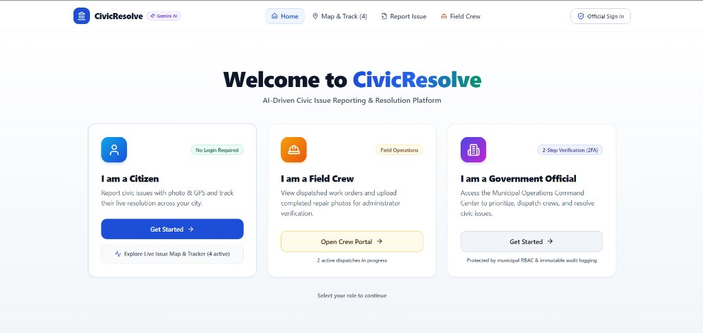
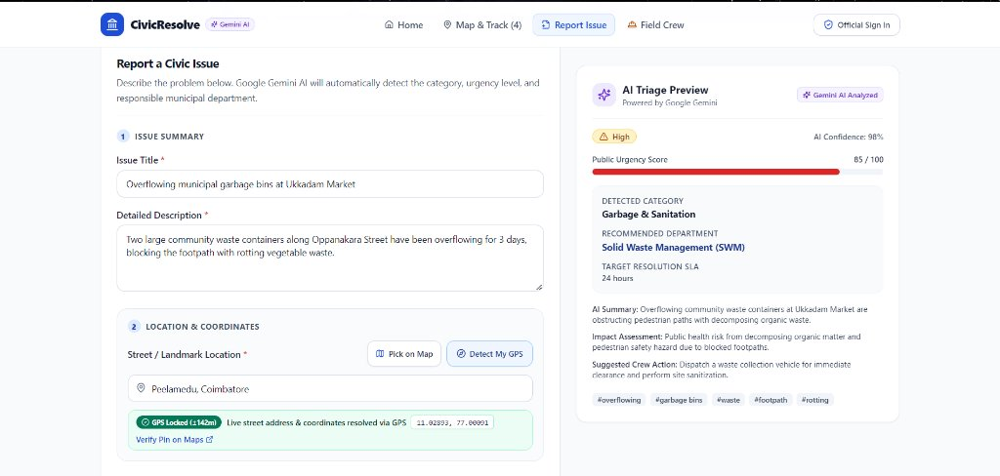
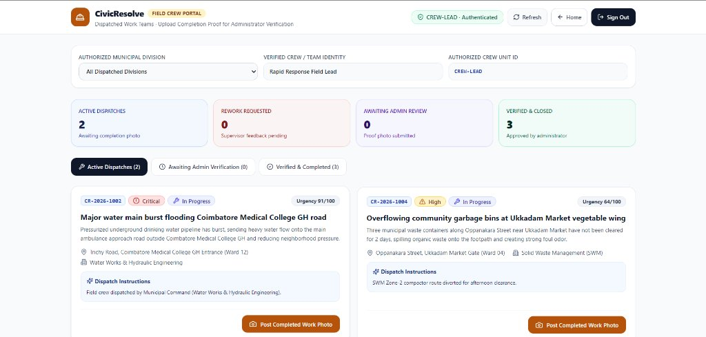
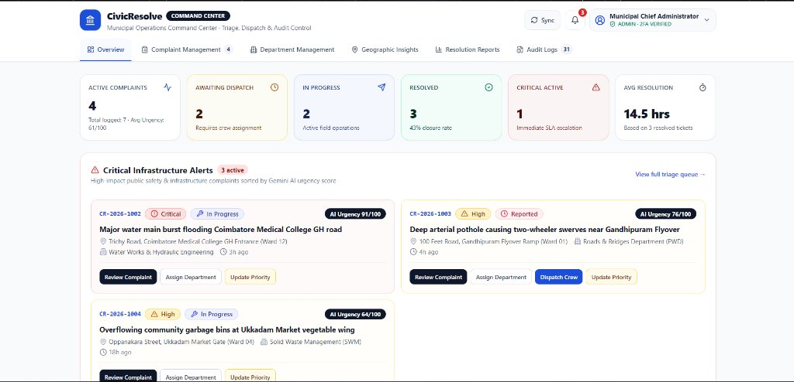
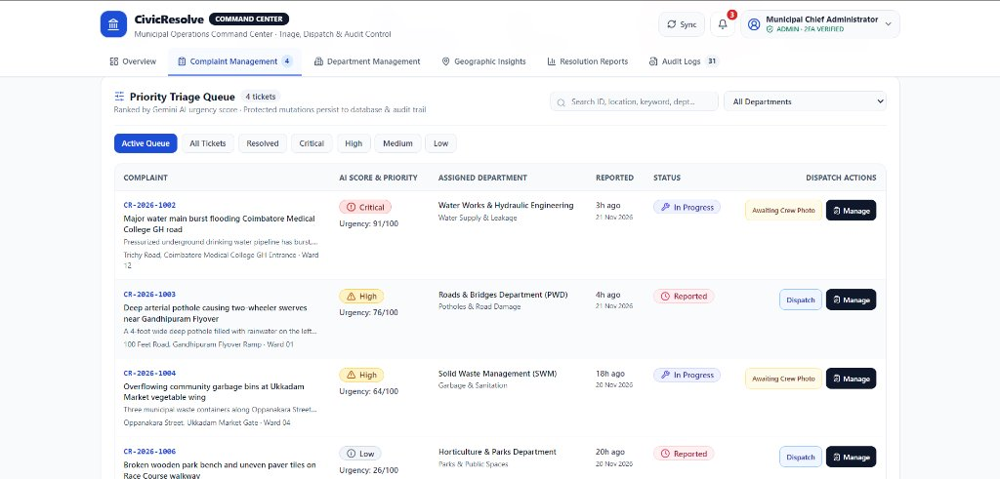
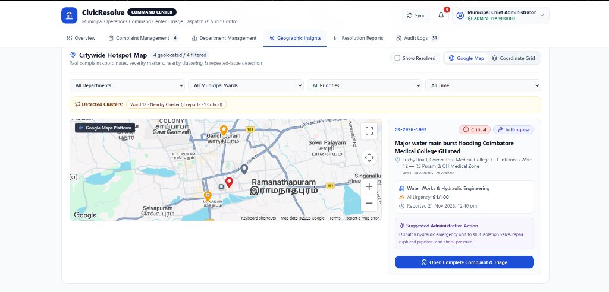

# CivicResolve — AI-Powered Municipal Issue Reporting & Operations Platform

Built for **PromptWars 2026**, **CivicResolve** connects citizens, dispatched municipal field crews, and city administrators in one end-to-end civic resolution workflow tailored for **Coimbatore**. Powered by **Google Gemini AI**, **Google Cloud Firebase**, and **Google Maps Platform**, CivicResolve triages complaints automatically, routes work orders to municipal divisions, verifies field completion with **SHA-256 photo plagiarism detection**, and records every decision in an **immutable audit trail**.

* **Live Deployment:** https://civic-resolve-three.vercel.app
* **GitHub Repository:** https://github.com/Lakshith007/civic-resolve

---

## Chosen Vertical & Persona

* **Vertical:** Smart Municipal Governance / CivicTech — AI-assisted public infrastructure reporting, automated departmental dispatch, and verifiable field remediation.
* **Target Personas:**
  1. **Citizens & Commuters (Zero-Login):** Urban residents in Coimbatore reporting potholes, exposed live wires, water main bursts, overflowing bins, and blocked drains using GPS or interactive map pins without account friction.
  2. **Municipal Field Crews (`WORKER`):** Division-scoped repair units (`CREW-E4` Electrical, `CREW-H2` Hydraulic, `CREW-PWD2` Roads/PWD, `CREW-SWM1` Solid Waste, `CREW-LEAD` Rapid Response) viewing assigned dispatches and submitting photographic proof of repair.
  3. **Municipal Operations Administrators (`ADMIN`):** Control-desk dispatchers and supervisors authenticating via 2FA to triage AI-ranked queues, inspect spatial hotspots, verify Before/After crew evidence, and audit all state transitions.

---

## Approach and Logic

* **Multimodal AI Triage with Deterministic Fallback (`src/lib/aiClassifier.ts`):** Evaluates complaint title, description, location, and optional compressed image via Google Gemini REST (`gemini-flash-lite-latest` primary, `gemini-3-flash-preview` fallback) to emit structured JSON (`category`, `priority`, `urgencyScore` `1–100`, `department`, `estimatedResolutionSla`, `impactAssessment`, `suggestedAction`, `detectedKeywords`). When `GEMINI_API_KEY` is omitted or unreachable, `classifyWithHeuristic` deterministically matches category keywords, adds safety amplifiers (`live wire`, `sparking`, `burst`, `open manhole`, `sinkhole`, `hospital`, `school`, `flooding`), applies dampeners (`minor`, `cosmetic`, `routine`), and maps scores (`>=80` Critical, `>=60` High, `>=35` Medium, `<35` Low) to SLA tiers.
* **Context-Aware Duplicate & Hotspot Clustering:** `findPotentialDuplicates` compares active (`status !== 'Resolved'`) same-category tickets for location and keyword token overlap so residents boost (`+1`) existing reports instead of duplicating dispatches. In `AdminHotspotMap.tsx`, Haversine proximity (`<= 1.5 km`) surfaces geographic clusters alongside repeated ward-category alerts.
* **Crew-Proof-Before-Resolve Gate & SHA-256 Anti-Plagiarism (`src/lib/issueStore.ts`):** Server-side workflow enforcement (`PATCH /api/issues/[id]`) rejects direct admin resolution (`400`) until a division-authorized field crew posts completion proof via `POST /api/worker/submit-proof`. Each uploaded photo is hashed with `SHA-256` and rejected (`WORKER_PLAGIARISM_BLOCKED`) if it matches the citizen's *"Before"* photo or any photo previously submitted on another ticket. Admins must approve (`Resolved`) or reject (`Rejected` -> rework) after inspecting Before/After images.
* **Hardened RBAC & Dual-Layer Persistence (`src/lib/authStore.ts`, `src/lib/authGuards.ts`, `src/lib/firebase.ts`):** Enforces `scrypt` password hashing, HMAC-SHA256 signed `HttpOnly` session cookies (`civic_session`), single-use HMAC-signed 2FA OTP challenges, same-origin CSRF validation, IP rate limiting, magic-byte PNG/JPEG/WebP upload verification (SVG blocked), and public PII stripping (`reporterContact` / `reporterUserId`), backed by two-way Cloud Firestore sync (`civic_issues`, `civic_audit_logs`) with local JSON/memory fallback.

---

## How the Solution Works

1. **Citizen Report & Geo-Triage (`/`):** A citizen chooses *I am a Citizen -> Get Started*, selects a Coimbatore preset or fills the form, optionally attaches a photo (auto-compressed client-side via `src/lib/imageCompress.ts` from `<= 10 MB` to `<= 380 KB` JPEG), and sets coordinates via **Detect My GPS** or **Pick on Map** (`LocationPickerMap.tsx` + reverse-geocoding). **Analyze with Gemini AI** previews severity and nearby duplicates (`POST /api/analyze`); **Submit Civic Report** (`POST /api/issues`) recomputes AI triage server-side to prevent score tampering and persists to Firestore.
2. **Public Transparency Tracker (`Map & Track`):** Displays live KPIs (*Active Open Issues*, *In Progress*, *Resolved*, *Avg AI Urgency*), Coimbatore **Google Map** (`CivicGoogleMap.tsx`) and **Spatial Grid** views (hiding resolved pins by default), community upvoting (`+1`), and a 3-stage resolution timeline stepper (`CivicBadges.tsx`).
3. **Admin Triage & Dispatch (`/admin`):** An administrator completes 2-Step Verification (`AdminAuthModal.tsx` -> `POST /api/auth/login`), reviews the 6-tab Command Center (*Overview*, *Complaint Management*, *Department Management*, *Geographic Insights*, *Resolution Reports*, *Audit Logs*), optionally overrides priority with a mandatory logged reason, and dispatches tickets to `In Progress`.
4. **Field Crew Proof Submission (`/worker`):** A field team signs in (`WorkerAccessGate.tsx` -> `POST /api/auth/worker-login`), sees only jobs scoped to its municipal division (`WorkerPortalClient.tsx`), and uploads a `SHA-256` verified completion photo (`POST /api/worker/submit-proof`).
5. **Supervisor Verification & Closure (`/admin`):** The administrator compares **Before vs. After** photos in the Verification Queue and clicks **Verify Photo & Mark Completed** (closing the ticket as `Resolved` and publishing `resolutionEvidenceUrl`) or **Reject & Request Rework** (surfacing rejection feedback on the crew's job card).

---

## Assumptions Made

* **Demo 2FA & Pre-Seeded Field Crew Accounts:** To enable instant end-to-end judging without external SMTP/SMS providers, `POST /api/auth/login` surfaces a `demoCode` preview inside the 2FA modal and `WorkerAccessGate` includes 1-click demo crew credentials (`CREW-LEAD`, `CREW-E4`, `CREW-H2`).
* **Base64 Image Storage Inside Firestore Documents:** To avoid external object-storage provisioning/CORS setup during deployment, photos are compressed client-side (`max 1024px`, `<= 380 KB` target data URI in `src/lib/imageCompress.ts`) and capped at `1.5 MB` server-side (`src/lib/validation.ts`) so issue records stay under Firestore's 1 MiB document ceiling.
* **Coimbatore Municipal Scope & Free-Tier Reverse-Geocoding:** Seed data (`CR-2026-1001`–`CR-2026-1006`), default map center (`11.0168, 76.9558`), ward taxonomy, and Spatial Grid bounds are calibrated for Coimbatore; street reverse-geocoding uses OpenStreetMap Nominatim with graceful coordinate-pin fallback if unavailable or throttled.
* **Serverless Container State:** Rate-limit buckets, 2FA burn/attempt maps (`__civic2FABurned`, `__civic2FAAttempts`), and local JSON files (`data/*.json`) run per container, while Cloud Firestore synchronizes tickets and audit trails across Vercel serverless instances.
* **Zero-Login Citizen UX:** Citizens report and track issues anonymously without signing in; `POST /api/auth/register` is retained strictly as an API-level RBAC contract test target enforcing default `CITIZEN` role assignment.

---

## Screenshots

### 1. Role-Selection Landing Portal (`/`)


### 2. Citizen Report Form, GPS Verification & Gemini AI Triage (`/`)


### 3. Field Crew Portal — Division-Scoped Dispatches (`/worker`)


### 4. Municipal Command Center — Overview & Critical Alerts (`/admin`)


### 5. Admin Priority Triage Queue (`/admin` → Complaint Management)


### 6. Citywide Hotspot Map & Spatial Clustering (`/admin` → Geographic Insights)


---

## Three-Portal Role Architecture

### 1. Citizen Portal (`/`) — Zero Login Required
* **Role-Selection Landing:** Clean separation between Citizen Reporting/Tracking, Field Crew Operations, and Government Official Command Center.
* **Smart Location & Map Picker:** Citizens do not need to guess administrative ward numbers — choose **Detect My GPS** or **Pick on Map** (interactive draggable Google Maps pin with live address lookup).
* **1-Click Coimbatore Demo Scenarios:** Pre-filled emergency and routine civic presets across Peelamedu, Coimbatore Medical College GH, Gandhipuram, and Ukkadam Market.
* **Live Gemini AI Triage Preview & Duplicate Guard:** Shows AI category, priority, urgency score (`1–100`), department routing, target SLA, and active nearby duplicate tickets before submission.

### 2. Field Crew / Worker Portal (`/worker`) — Department-Scoped `WORKER` RBAC
* **Protected Access Gate:** Dedicated Crew Sign-In Gate issuing HMAC-SHA256 signed `HttpOnly` session cookies scoped to the unit's municipal division.
* **Dispatched Work Queue & SHA-256 Plagiarism Block:** Inspects `In Progress` jobs, submits completion photos via `POST /api/worker/submit-proof`, blocks photo reuse (`WORKER_PLAGIARISM_BLOCKED`), and displays supervisor rework requests.

### 3. Municipal Operations Command Center (`/admin`) — 2-Step Verification (`ADMIN` RBAC)
* **Municipal 2-Step Verification (2FA):** Single-use, HMAC-signed 6-digit OTP challenge (5-minute expiry, 5-attempt lockout).
* **Six Operations Tabs & Audit Trail:** *Overview*, *Complaint Management*, *Department Management*, *Geographic Insights*, *Resolution Reports*, and *Audit Logs* tracking all auth, triage, override, plagiarism, and verification actions.

---

## Demo Accounts (Pre-Configured)

| Role | Identifier / Email | Password / Passcode | Scope |
| --- | --- | --- | --- |
| **Administrator (2FA)** | `admin@civicresolve.gov` | `CivicAdmin@2026!Secure` | Full Command Center (`/admin`) + 6-digit OTP auto-fill |
| **Field Lead** | `CREW-LEAD` | `Crew@Lead!2026` | All Municipal Divisions (`/worker`) |
| **Electrical Crew** | `CREW-E4` | `Crew@E4!2026` | Electrical & Streetlighting Division only (`/worker`) |
| **Hydraulic Crew** | `CREW-H2` | `Crew@H2!2026` | Water Works & Hydraulic Engineering only (`/worker`) |

---

## Tech Stack

* **Framework:** Next.js 14 (App Router, TypeScript), React 18
* **Styling & Icons:** Tailwind CSS, `lucide-react`
* **AI Engine:** Google Gemini REST API (`gemini-flash-lite-latest` primary, `gemini-3-flash-preview` fallback) + deterministic `smart-civic-fallback` (`src/lib/aiClassifier.ts`)
* **Database & Cloud:** Google Cloud Firebase (`civic-sence-4ef70`) — two-way Cloud Firestore sync (`civic_issues`, `civic_audit_logs`) + Analytics + local JSON/memory fallback
* **Maps & Geocoding:** Google Maps Platform (Maps JavaScript API, `loading=async`) + OpenStreetMap Nominatim reverse-geocoding
* **Testing & Linting:** Vitest (`src/__tests__/`) & ESLint (`next/core-web-vitals`)

---

## Getting Started Locally

### 1. Install Dependencies
```bash
npm install
```

### 2. Configure Environment Variables
Copy `.env.example` to `.env.local` and supply your keys:
```bash
cp .env.example .env.local
```

| Variable | Purpose |
| --- | --- |
| `GEMINI_API_KEY` | Google Gemini API key (falls back to `smart-civic-fallback` if omitted) |
| `SESSION_SECRET` | 32+ char hex HMAC secret for signing session & 2FA tokens |
| `ADMIN_BOOTSTRAP_EMAIL` / `PASSWORD` / `NAME` | Server-bootstrapped municipal administrator account |
| `NEXT_PUBLIC_FIREBASE_*` | Google Firebase web SDK credentials (`API_KEY`, `AUTH_DOMAIN`, `PROJECT_ID`, `STORAGE_BUCKET`, `MESSAGING_SENDER_ID`, `APP_ID`, `MEASUREMENT_ID`) |
| `NEXT_PUBLIC_GOOGLE_MAPS_API_KEY` | Google Maps Platform Maps JavaScript API key |

### 3. Run Development Server, Lint, Tests & Build
```bash
npm run dev      # http://localhost:3000
npm run lint     # Next.js ESLint check
npm test         # Vitest unit, RBAC/security & E2E tests
npm run build    # Production Next.js build
npm start        # Serve production build
```

---

## Project Structure

```text
civic-resolve/
├── .env.example
├── .eslintrc.json
├── firebase.json & firestore.rules
├── next.config.mjs
├── package.json
├── vitest.config.ts
└── src/
    ├── __tests__/
    │   ├── civic.test.ts                   # AI fallback classifier, validation & Coimbatore store tests
    │   ├── security.rbac.test.ts           # RBAC, 2FA OTP, Worker auth & SHA-256 plagiarism tests
    │   └── workflow.e2e.test.ts            # Full Citizen -> AI -> Crew Proof -> Admin Approve E2E test
    ├── app/
    │   ├── api/
    │   │   ├── admin/analytics/route.ts    # GET: Admin KPIs & audit logs
    │   │   ├── admin/complaints/route.ts   # GET: Full unstripped complaint queue
    │   │   ├── analyze/route.ts            # POST: Gemini AI triage & Firestore-hydrated duplicate check
    │   │   ├── auth/
    │   │   │   ├── login/route.ts          # POST: Admin 2-Step Verification (credentials + 2FA OTP)
    │   │   │   ├── logout/route.ts         # POST: Session revocation + audit entry
    │   │   │   ├── me/route.ts             # GET/PATCH: Session introspection
    │   │   │   ├── register/route.ts       # POST: Locked citizen registration endpoint
    │   │   │   └── worker-login/route.ts   # POST: Crew Unit ID + passcode authentication
    │   │   ├── issues/route.ts             # GET/POST: Public listing (PII-stripped) & creation
    │   │   ├── issues/[id]/route.ts        # GET/PATCH: Detail view, upvoting, Admin triage & photo approval
    │   │   └── worker/submit-proof/route.ts# POST: Worker completion proof + SHA-256 plagiarism block
    │   ├── admin/page.tsx & dashboard/     # Server-guarded Admin Command Center
    │   ├── worker/page.tsx                 # Server-guarded Field Crew Portal
    │   ├── icon.svg, layout.tsx & page.tsx # App icon, metadata & 3-role landing + Citizen Portal
    ├── components/
    │   ├── AdminAccessGate.tsx             # Admin unauthenticated screen with 2FA modal trigger
    │   ├── AdminAuthModal.tsx              # 2-Step Admin credential + 6-digit OTP modal
    │   ├── AdminCommandClient.tsx          # Admin header, notifications, profile menu & 6-tab router
    │   ├── AdminDashboard.tsx              # KPIs, Critical Alerts, Before/After Review, Workloads, Queue & Audit
    │   ├── AdminHotspotMap.tsx             # Filtered hotspot map with Haversine clustering & Show Resolved toggle
    │   ├── CivicBadges.tsx                 # Priority/Status/Engine badges & Resolution Timeline stepper
    │   ├── CivicGoogleMap.tsx              # Coimbatore Google Maps renderer (auto-hides resolved pins)
    │   ├── LocationPickerMap.tsx           # Interactive click/drag map pin selector
    │   ├── ReportIssueForm.tsx             # Citizen form, GPS + reverse-geocoding, Pick on Map & AI Preview
    │   ├── TrackingDashboard.tsx           # Citizen tracking board, Coimbatore Spatial Grid & hotspot map
    │   ├── WorkerAccessGate.tsx            # Field Crew Unit ID sign-in screen
    │   └── WorkerPortalClient.tsx          # Division-scoped dispatched jobs & completion proof uploader
    ├── lib/
    │   ├── aiClassifier.ts                 # Gemini multimodal client + fallback + duplicate detector
    │   ├── auditStore.ts                   # Immutable audit log + Firestore sync
    │   ├── authGuards.ts                   # requireAuth, requireCitizen, requireWorker, requireAdmin, CSRF & RL
    │   ├── authStore.ts                    # scrypt hashing, HMAC sessions, 2FA tokens & Crew accounts
    │   ├── dateFormat.ts                   # Deterministic IST date, age & duration formatters
    │   ├── firebase.ts                     # Firebase initialization & two-way Firestore sync
    │   ├── firebaseClient.ts               # Lightweight browser Firebase Analytics client (no Firestore SDK)
    │   ├── googleMapsLoader.ts             # Shared Google Maps async loader & gm_authFailure handler
    │   ├── imageCompress.ts                # Client canvas photo resizing & JPEG compression
    │   ├── issueStore.ts                   # Coimbatore seed store, proof/approval & SHA-256 duplicate photo check
    │   └── validation.ts                   # Sanitization & PNG/JPEG/WebP magic-byte enforcement
    └── types/
        └── civic.ts                        # Shared TypeScript contracts & Coimbatore wards/departments
```
